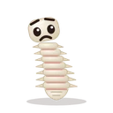

# Claude Pet

A tiny desktop pet (Mochi) that lives in a transparent, frameless, always-on-top
window, cheers you on while you work, and chats through your local Claude Code CLI.

<p align="center">
  
</p>

<p align="center"><a href="https://github.com/Ledsav/claude-pet/releases/latest"><b>Download for Windows</b></a></p>

- **Drag** the pet anywhere; **click** it for a wiggle.
- **Hover** to see food / mood / energy, the **feed**, **play**, **sleep** buttons and a chat box.
- **Tray icon**: left-click shows/hides the pet; right-click for feed, play, sleep,
  *Edit personality…* and quit. The tooltip shows current stats.
- Every 45 minutes (configurable) Mochi pipes up with a short pep talk.

## Moods

Food, mood and energy drain over time (even while the app is closed), and the pet shows it.
Pick the **Spine** skin and Mochi is replaced by **Spiny**, a sarcastic spine with its own
much ruder personality.

| | Happy | Sad | Hungry | Tired | Asleep | Goodbye |
| --- | :---: | :---: | :---: | :---: | :---: | :---: |
| **Mochi** |  |  |  |  |  |  |
| **Spiny** |  |  |  |  |  |  |

## Install (Windows)

1. Install [Claude Code](https://claude.com/claude-code) and run `claude` once in a
   terminal to log in.
2. Download `Claude Pet_<version>_x64-setup.exe` from the
   [latest release](https://github.com/Ledsav/claude-pet/releases/latest) and run it. It installs per-user (no admin
   needed). The installer isn't code-signed yet, so Windows SmartScreen may warn:
   *More info → Run anyway*.
3. Mochi appears bottom-right. If Claude Code is missing it says so; `/doctor` re-checks.
4. Optional: `/settings skin spine` (or blob, sprout, beancat, ember), `/settings name …`.

Everyone gets their own pet, save file and personality, and chats run on **their own**
Claude subscription through their own `claude` CLI. To update, run the newer installer
over the old one; stats and settings are kept. What gets sent to Claude is described in
the [privacy policy](PRIVACY.md).

**Uninstall:** *Settings → Apps → Installed apps → Claude Pet → Uninstall*. To also remove
the pet's saved data, delete `%APPDATA%\dev.claudepet.desktop\`.

You can also build from source: clone this repo and follow *Develop*.

## Chat commands

Type `/` in the chat box for suggestions (↑/↓ to pick, Tab to complete, Enter to run).
Commands are handled by the app and never sent to Claude.

| Command | Does |
| --- | --- |
| `/settings` | Show all settings |
| `/settings skin <blob\|sprout\|beancat\|ember\|spine>` | Change how the pet looks (Spine brings its own, much ruder, personality) |
| `/settings name <name>` | Rename the pet |
| `/settings model <haiku\|sonnet\|opus>` | Claude model for chat (default `haiku`) |
| `/settings motivate <minutes\|off>` | How often it gives unprompted pep talks (default 45) |
| `/settings speed <0–10>` | Stat decay multiplier; `0` pauses time |
| `/settings ontop <on\|off>` | Always on top |
| `/settings limit <1–200>` | Max chats per hour (default 30) |
| `/motivate` | Pep talk right now |
| `/stats` | Exact stat numbers |
| `/doctor` | Check the Claude Code CLI is installed |
| `/personality` · `/personality reset` | Open the personality file · restore the default |
| `/clear` | Forget the conversation |
| `/reset confirm` | Hatch a brand-new pet |

## How it works

| Piece | Where |
| --- | --- |
| Stats, decay, actions | `src-tauri/src/stats.rs`: ticks every 5 s, catches up on time the app was closed |
| Settings & commands | `src-tauri/src/settings.rs`, autocomplete in `src/complete.ts` |
| Chat & pep talks | `src-tauri/src/chat.rs`: runs `claude -p "<prompt>"` |
| Sprites | `public/sprites/<skin>.png`, generated by `scripts/sprites/` (see below) |
| Save files | `%APPDATA%\dev.claudepet.desktop\` → `pet.json`, `settings.json` |
| Personality | `%APPDATA%\dev.claudepet.desktop\brain\CLAUDE.md`, seeded from `src-tauri/personality/CLAUDE.md`. Skins with their own personality (Spine) use `brain-<skin>\` instead, seeded from `src-tauri/personality/<skin>.md` |

Chat runs `claude` with its working directory set to the `brain` folder, so Claude Code
loads that folder's `CLAUDE.md` as the pet's personality. Edit it to change who Mochi
is. Each prompt carries the pet's name, current stats and the last 6 exchanges. The CLI
runs with all tools disabled (`--tools ""`), no MCP servers, no session persistence and
without user-level settings/hooks, so the pet can only talk.

Rate limits: one message in flight, at least 4 s apart, at most 30 per hour (shared with
pep talks), 90 s timeout. When Claude is unavailable, pep talks fall back to built-in lines.

## Sprites

Each skin is one PNG atlas: 8 columns × 11 rows of 128 px frames (rendered at 2× for
HiDPI). Rows: idle, happy, sad, hungry, tired, sleep, eat, play, talk, wiggle, bye.
`src/sprites.json` lists each row's frame count and per-frame durations.

Skins are drawn procedurally in `scripts/sprites/skins.mjs`; animations live in
`scripts/sprites/generate.mjs`. After changing either, regenerate (needs Chrome or Edge):

```bash
node scripts/sprites/generate.mjs
```

To use hand-drawn art instead, replace `public/sprites/<skin>.png` with a sheet of the
same layout.

## Develop

Needs Node 20+, Rust (MSVC toolchain on Windows) and a logged-in `claude` CLI.

```bash
npm install
npm run tauri dev
```

```bash
cd src-tauri && cargo test
```

`cargo test -- --ignored` also runs a live test against the real `claude` CLI.

Build the installer:

```bash
npm run tauri build
```

### Releasing

Bump `version` in `package.json`, `src-tauri/Cargo.toml` and `src-tauri/tauri.conf.json`,
commit, then push a matching tag:

```bash
git tag v0.2.0 && git push origin v0.2.0
```

The *Release* workflow runs the tests, builds the installer on GitHub Actions and
publishes it as a GitHub Release.

## Code signing policy

Free code signing provided by [SignPath.io](https://about.signpath.io/), certificate by
[SignPath Foundation](https://signpath.org/). *(Applied for; releases so far are unsigned.)*

Release installers are built only by the *Release* workflow on GitHub Actions, from the
source in this repository, and each signing request is approved by hand.

- Committers and reviewers: [Alberto Valdes Rey (Ledsav)](https://github.com/Ledsav)
- Approvers: [Alberto Valdes Rey (Ledsav)](https://github.com/Ledsav)

**Privacy:** this program will not transfer any information to other networked systems
unless specifically requested by the user or the person installing or operating it. Chat
messages and pep talks go to Anthropic through the Claude Code CLI you installed and
logged in to; see the [privacy policy](PRIVACY.md) for exactly what is sent.

## License

[MIT](LICENSE)
